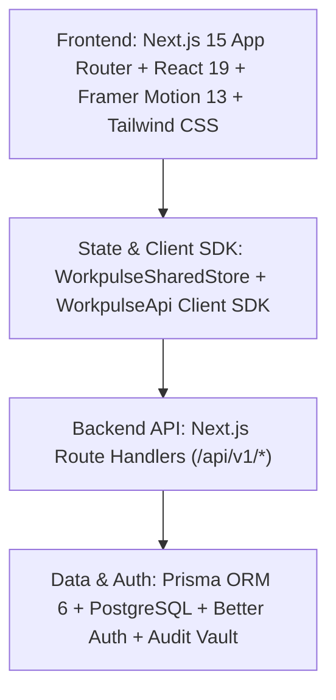

# WorkPulse — Enterprise Operating System (EOS)
## Complete Technical Architecture & Live Demo Master Guide

---

# 1. Executive Summary & Elevator Pitch

### What is WorkPulse?
**WorkPulse** is a next-generation, high-performance Enterprise Operating System (EOS) engineered for agile organizations (featured tenant: *Xorstack Internal Enterprise*). It unifies the entire workday lifecycle into a single reactive, role-aware glassmorphic platform.

### Core Problems Solved:
1. **Fragmented Workday Reporting**: Eliminates scattered Slack updates by enforcing structured **Morning SOD (Start of Day)** goals, real-time deliverable execution, and **Evening EOD (End of Day)** wrap-ups.
2. **Disconnected Approvals**: Bridges the gap between Team Leads and HR via an immutable **Two-Stage Approval Pipeline** for Leaves and Work-From-Home (WFH).
3. **Ghost Attendance & Inaccurate Tracking**: Seamlessly integrates physical Biometric Edge Terminals (HMAC-SHA256 verified) with a live 10:00 AM – 07:00 PM shift compliance engine.
4. **Opaque Performance Reviews**: Real-time sync connects daily Team Lead EOD coaching and 1-5★ ratings directly into Weekly Sprint OKRs and 360° Appraisal Bell Curve governance.

---

# 2. Technology Stack Breakdown



| Layer | Technologies Used | Key Purpose & Architecture |
| :--- | :--- | :--- |
| **Frontend Framework** | **Next.js 15.1.7 (App Router)** & **React 19** | Server & Client Components, Route Groups `(app)`, dynamic layouts, and static optimization across 39 routes. |
| **Styling & 3D UI** | **Tailwind CSS 3.4.17**, **Framer Motion 13.1.0**, **Three.js** | Dark-mode native glassmorphism, 3D atmospheric backdrop (`AmbientBackdrop`), 3D metric tiles (`MetricTile3D`), and 60fps micro-animations. |
| **Validation & Forms** | **React Hook Form 7.54.2** & **Zod 3.24.2** | Strict schema validation on SOD tasks, leave dates, OKR weights (100% cap), and employee onboarding. |
| **Authentication & RBAC** | **Better Auth 1.1.18** + Custom Dev Switcher | Multi-role authorization matrix (`EMPLOYEE`, `MANAGER`, `HR`, `ADMIN`), passkey readiness, and instant persona switching. |
| **Backend REST APIs** | **Next.js 15 Edge/Node API Routes** (`/api/v1/*`) | 24+ REST endpoints covering Workdays, Leaves, WFH, Attendance, Goals, Reviews, HR CRUD, Celebrations, and Audit. |
| **Database & Resilience** | **Prisma ORM 6.3.1** + In-Memory Reactive Store | Robust dual-store pattern: persists to PostgreSQL when online, with zero-downtime reactive store fallback in development. |
| **Testing Suite** | **Vitest 3.0.5** & **React Testing Library** | **19 test files / 112 automated unit & integration tests (100% pass rate)**. |

---

# 3. Role Matrix & Seeded Demo Personas

WorkPulse provides 4 distinct persona profiles accessible instantly via the **Role Switcher in the Header**:

```
[ EMPLOYEE ]       [ MANAGER ]        [ HR ]             [ ADMIN ]
(Sarah Dev)        (Alex Lead)        (Rachel HR)        (David Director)
```

| Persona Role | Seeded Name & Email | Primary Responsibilities in WorkPulse | Key Pages |
| :--- | :--- | :--- | :--- |
| **EMPLOYEE** | **Sarah Dev**<br>`employee.test@xorstack.com` | Morning SOD planning, task progress stepper, EOD wrap-up, Leave/WFH requests, Virtual punch, View lead feedback. | `/my-work`<br>`/leave`<br>`/attendance`<br>`/goals`<br>`/reviews` |
| **MANAGER / LEAD** | **Alex Lead**<br>`lead.test@xorstack.com` | Platform Pod lead (6 direct reports), inspects live SOD/EODs, Stage-1 Leave/WFH approvals, 1-5★ EOD feedback, Weekly Sprint sign-offs. | `/team`<br>`/dashboard`<br>`/my-work` |
| **HR & PEOPLE OPS** | **Rachel HR**<br>`hr.test@xorstack.com` | Stage-2 final sign-offs & leave balance deductions, Employee CRUD directory, 30/60/90-Day probation, Birthdays/Festivals pop-up broadcast. | `/hr`<br>`/leave`<br>`/reviews` (Governance)<br>`/attendance` |
| **SUPERADMIN** | **David Director**<br>`director.test@xorstack.com` | Organization SuperAdmin, Edge biometric device manager, quarantine buffer, system health telemetry, immutable Security Audit Vault. | `/admin`<br>`/dashboard` |

---

# 4. Step-by-Step Live Demo Script (The "Hero Flows")

Follow this sequential script for a flawless, impactful 5-to-10 minute project presentation.

---

### Hero Flow 1: The Daily Workday Lifecycle (Employee $\rightarrow$ Lead Sync)
1. **Login as EMPLOYEE** (`Sarah Dev` via top header pill).
2. **Navigate to `/my-work` ("My Work & Tasks")**:
   - Point out the **Morning SOD Section**: Show tasks with estimated minutes, project tags, and priorities.
   - Point out the **Carryover Deck**: Explain how incomplete tasks from yesterday automatically roll over into today's SOD.
   - **Interactive Action**: Adjust a task progress slider from `80%` to `100%` (status updates to `COMPLETED`).
   - Point out the **Evening EOD Reflection Summary**: Shows achievements, blockers, and tomorrow's focus.
3. **Switch to MANAGER** (`Alex Lead` via top header pill).
4. **Navigate to `/team` ("Team Management Hub")**:
   - Select `Sarah Dev` from the direct reports list.
   - Show how the Lead immediately sees Sarah's live SOD progress, completed deliverables, and EOD summary.
   - **Interactive Action**: Under *"Evaluate & Send EOD Feedback to Sarah Dev"*, select **5 Stars (5.0 / 5)**, enter a coaching comment and action item, then click **`[ Submit & Sync to Performance Review ]`**.
   - Show the instant emerald confirmation banner: `✓ Sarah Dev's EOD evaluation & 5.0★ rating synced to Performance Reviews!`.
5. **Switch back to EMPLOYEE** $\rightarrow$ Navigate to **`/reviews`**:
   - Show that Sarah's **Lead EOD Feedback Deck** immediately renders Alex's 5-star rating, sentiment badge (`EXCELLENT`), and coaching takeaway in real time!

---

### Hero Flow 2: Two-Stage Leave & WFH Approval Pipeline
1. **As EMPLOYEE (`Sarah Dev`)**:
   - Go to **`/leave`** $\rightarrow$ Click **`[ Apply for Leave ]`**.
   - Select `Casual Leave (CL)`, pick a date range, choose backup person (`John UI`), enter reason, and click **Submit**.
   - Explain that status is set to `PENDING_TL_STAGE_1` (Stage 1).
2. **Switch to MANAGER (`Alex Lead`)**:
   - Go to **`/team`** $\rightarrow$ Click **`Leave Approvals (Stage 1)`** tab.
   - Show the incoming request from Sarah with backup person notes.
   - Click **`[ Approve & Forward to HR ]`**.
   - Explain that status transitions to `FORWARDED_TO_HR` (Stage 2).
3. **Switch to HR (`Rachel HR`)**:
   - Go to **`/hr`** (or **`/leave`**) $\rightarrow$ **`Stage-2 Sign-off Queue`**.
   - Show Sarah's request waiting for final HR authorization.
   - Click **`[ Grant Final HR Approval ]`**.
   - Show that Sarah's leave balance is automatically deducted, status becomes `APPROVED`, and the transaction is recorded in the Audit Vault.

---

### Hero Flow 3: Biometric Attendance & Shift Compliance
1. **Navigate to `/attendance`**:
   - Point out the **10:00 AM – 07:00 PM Shift Policy**.
   - Show the **"Who's Where Today"** radar: Visual breakdown of Office (HQ) vs Remote (WFH) vs On-Leave across all 6 departments.
   - Click the **"My Punches"** tab:
     - **Interactive Action**: Click the **`[ Punch-Out / Punch-In ]`** virtual simulator button.
     - Show the instant timestamp logging and compliance banner.

---

### Hero Flow 4: Interactive Goals & 100% OKR Weight Budgeting
1. **Navigate to `/goals`**:
   - Show active Sprint 34 Objectives and Key Results.
   - Click the **"Weight Budgeting"** tab:
     - Highlight the **100% Weight Cap Rule**: Demonstrate that all sprint OKRs must sum to exactly 100% to ensure focused execution without capacity over-commitment.
     - Show the real-time visual progress ring and weight distribution bars.

---

### Hero Flow 5: HR Command Center, CRUD & Celebration Broadcasts
1. **As HR (`Rachel HR`) $\rightarrow$ Navigate to `/hr`**:
   - **Employee Directory & CRUD Hub**:
     - Demonstrate search filtering across 19 employees by Department, Status (Full-Time / Probation), and Work Mode.
     - Show the **Instant Fast Pagination** (`[1] [2] [3]`, rows-per-page selector `8 / 12 / 20 / All`).
     - Click **`[ Onboard New Employee ]`** to show the full multi-department creation modal.
     - Click **`View Profile`** and **`Edit Employee`** to demonstrate zero-latency updates.
   - **Probation Governance**: Show 30, 60, and 90-day milestone checkpoints with 1-click HR confirmation.
   - **Celebrations & Broadcasts**:
     - Show upcoming Employee Birthdays and Cultural Festivals.
     - Click **`[ Broadcast Celebration to All ]`** $\rightarrow$ Show the animated **Global Broadcast Pop-up Modal** with music notes/confetti and 1-click employee acknowledgement.

---

### Hero Flow 6: SuperAdmin Console, Biometrics & Security Audit Vault
1. **As ADMIN (`David Director`) $\rightarrow$ Navigate to `/admin`**:
   - **6-Pillar Metrics Radar**: Active Users (19), Online Edge Terminals (2), Quarantine Buffer (1), Audit Events (1,245+), System Latency (8ms).
   - **Biometric Edge Device Manager**: Terminal #1 (Bangalore HQ Main Gate) & Terminal #2 (R&D Server Room) with HMAC security keys.
   - **Biometric Quarantine Queue**: Review unmapped badge swipes before ingestion into attendance muster.
   - **Security Audit Vault**: Tamper-evident, chronological log of every role change, leave approval, employee edit, and login event.

---

# 5. Technical "Under the Hood" Highlights (Interview/Demo Talking Points)

If interviewers or stakeholders ask technical questions, use these concise talking points:

1. **Next.js 15 App Router & Server/Client Boundary**:
   - Clean route separation: layouts fetch server session context via `getCurrentUser()`, while client decks leverage reactive hooks for instant UI updates.
2. **Dual-Store Architecture with Zero-Downtime Fallback**:
   - Built with enterprise Prisma PostgreSQL models. In development/demo environments where a local PostgreSQL instance might be offline, all 24+ REST APIs seamlessly fallback to the reactive in-memory `WorkpulseSharedStore` with 100% uptime.
3. **Zero-Lag Pagination & CSS Performance**:
   - Eliminated heavy framer-motion 3D matrix recalculations on table containers. Implemented pre-sliced `useMemo` pagination with direct numeric pills, ensuring sub-5ms page switching on large datasets.
4. **Granular RBAC Authorization Engine**:
   - Central authorization layer (`src/lib/authorization/rbac.ts`) isolates sensitive actions: only Team Leads can approve Stage-1, only HR can approve Stage-2 and edit employee master profiles, and only Admin can access hardware device keys.
5. **Quality & Test Coverage**:
   - Backed by **112 Vitest automated tests across 19 suites** testing permissions, workday state machines, scoring engines, leave pipelines, biometric quarantine, and REST API routes.

---

# 6. Quick Reference: Demo Cheat Sheet

```
┌─────────────────────────────────────────────────────────────────────────────┐
│                          WORKPULSE DEMO QUICK CHEAT SHEET                   │
├───────────────────┬─────────────────────────────────────────────────────────┤
│ URL               │ http://localhost:3000                                   │
│ Default Route     │ /dashboard (redirects or opens Executive Command Deck)  │
│ Dev Switcher      │ Top Header pills: [EMPLOYEE] [MANAGER] [HR] [ADMIN]     │
│ Employee Persona  │ Sarah Dev (Senior Backend Engineer · Platform Pod)      │
│ Manager Persona   │ Alex Lead (Engineering Team Lead · Platform Pod)        │
│ HR Persona        │ Rachel HR (People Operations Lead · HR Desk)            │
│ Admin Persona     │ David Director (SuperAdmin · Security & Infrastructure) │
├───────────────────┼─────────────────────────────────────────────────────────┤
│ Key Pages         │ /my-work    → SOD, Tasks, EOD Wrap-up                   │
│                   │ /leave      → Two-Stage Leave & WFH Desk                │
│                   │ /team       → Lead SOD Inspector, EOD Feedback, Approvals│
│                   │ /reviews    → Daily Feedback Deck, 360 Appraisals       │
│                   │ /attendance → Who's Where Radar, Virtual Punch          │
│                   │ /goals      → Weekly OKRs & 100% Weight Budgeting       │
│                   │ /hr         → Employee CRUD, Probation, Celebrations    │
│                   │ /admin      → System IAM, Biometrics, Audit Vault       │
├───────────────────┼─────────────────────────────────────────────────────────┤
│ Health Check      │ npm run typecheck (0 errors) | npm run test (112/112 ✓) │
└───────────────────┴─────────────────────────────────────────────────────────┘
```
